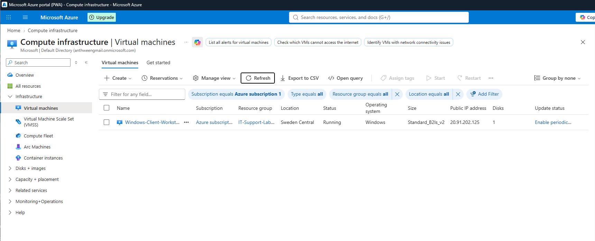
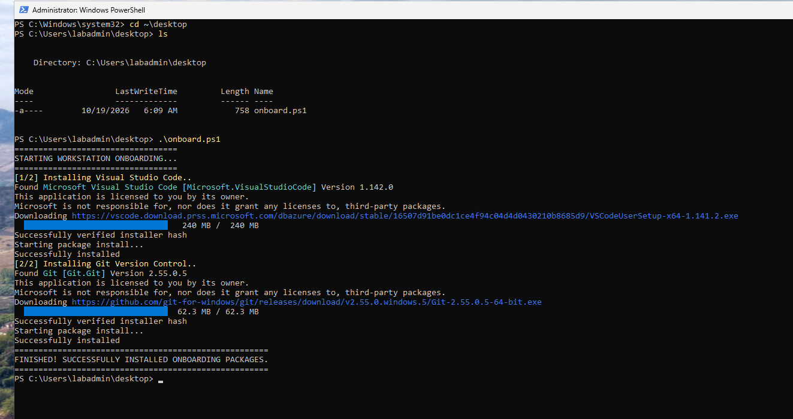
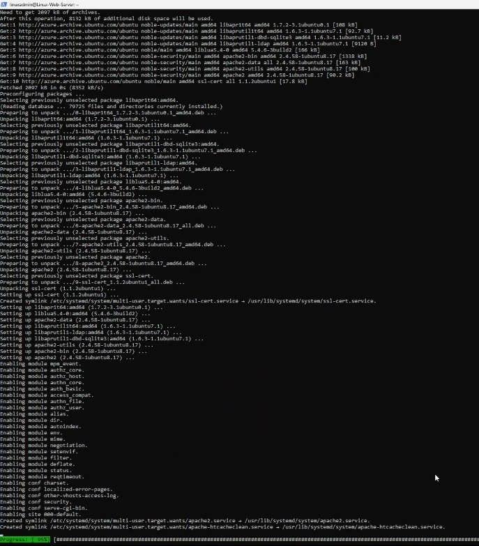
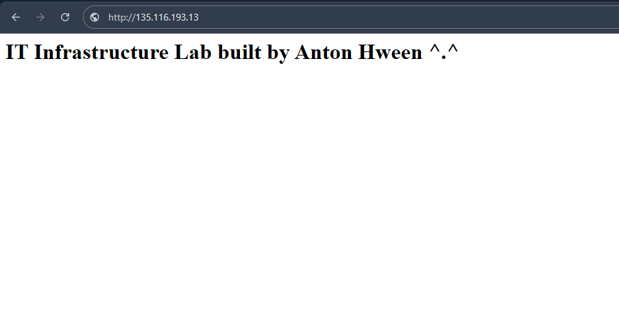

# Azure-Dual-OS-Deployment-Lab
This is an practical lab I built to show basic practical skills in cloud deployment, package management, and networking across different operating systems.

## Tools and Platform
* **Cloud Platform:** Microsoft Azure
* **Operating Systems:** Windows 11 Pro and Ubuntu Server (24.04) LTS
* **Shells used:** Powershell and Bash
* **Package Managers:** Winget for Windows and Apt for Linux

---

## What I built and Tested
* **Cloud Platform:** Monitored and managed the virtual machines using one Resource Group inside Azure.
* **Windows 11 Setup:** Wrote a Powershell script ('onboard.ps1') to silently install corp software (VS Code and Git), using 'winget' to bypass manual installer clicks.
* **Linux Infrastructure:** Connected to an Ubuntu server using SSH keys (after some troubleshooting of local file permissions using 'icacls'). Used 'apt' to launch an Apache web server.
* **Networking:** Configured Azures firewall rules to open Port 80 (HTTP) to host a custom live webpage over the internet.

---

  ## Project screenshots

  ### 1. Active Azure VMs
  

  ### 2. Windows Automation Script
  

  ### 3. Linux Package Installation
  

  ### 4. Live Public Endpoint
  
